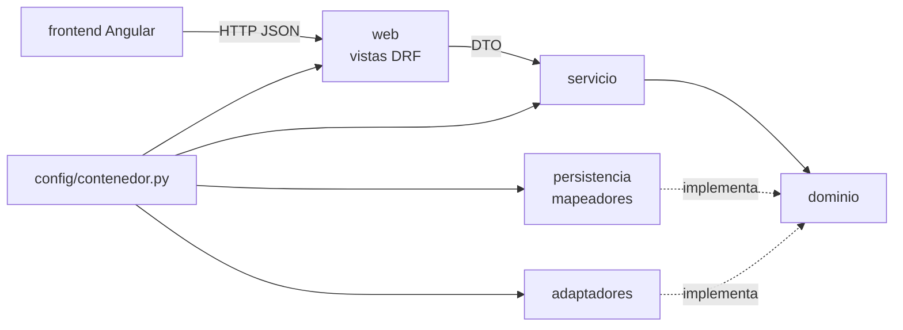

# Arquitectura

## 1. Capas y dependencias



Las flechas indican quién importa a quién. El dominio no apunta hacia ninguna capa: las demás dependen de él.

| Capa | Paquete | Puede importar | No puede importar |
|---|---|---|---|
| Dominio | `chibchaweb.dominio` | biblioteca estándar; `cryptography` solo en `dominio.respaldo` | django, rest_framework, servicio, persistencia, adaptadores, web |
| Servicio | `chibchaweb.servicio` | dominio | persistencia, adaptadores, web, django.db, rest_framework |
| Persistencia | `chibchaweb.persistencia` | dominio, django.db | servicio, adaptadores, web |
| Adaptadores | `chibchaweb.adaptadores` | dominio, httpx, bibliotecas de cada proveedor | servicio, persistencia, web |
| Web | `chibchaweb.web` | servicio (servicios + DTO), rest_framework, django | dominio, persistencia, adaptadores |
| Tareas | `chibchaweb.tareas` (management commands) | servicio, config.contenedor | dominio, persistencia, adaptadores |
| Contenedor | `config.contenedor` | todas | — |

`backend/.importlinter` verifica esta tabla.

## 2. La corrección: repositorios en el dominio

El diagrama DC-SRV-01 (EA) muestra los servicios con atributos `-usuarios: MapeadorUsuario`. Eso hace que el servicio dependa de la persistencia, y no debe ser así. La corrección (*Separated Interface* + *Repository*) es:

- El **dominio** define una interfaz por agregado en `chibchaweb/dominio/repositorios.py`: `RepositorioUsuario`, `RepositorioSuscripcion`, `RepositorioComision`, `RepositorioSolicitudDominio`, `RepositorioTicket`, `RepositorioMigracion` y `RepositorioCatalogo`. Cada una tiene **los mismos métodos públicos** que su mapeador en DC-PER-01 (ver `modelo/dominio.md`, sección *Repositorios*).
- El dominio define además `UnidadDeTrabajo` (`iniciar`, `confirmar`, `revertir`) para las operaciones que escriben varios agregados juntos.
- La **persistencia** cumple esas interfaces: `class MapeadorUsuario(Mapeador[Usuario], RepositorioUsuario)`. El Layer Supertype `Mapeador<T>` y sus operaciones protegidas no cambian.
- Los **servicios** reciben `RepositorioX` por constructor. No saben que existe un mapeador.

```python
# chibchaweb/dominio/repositorios.py
from abc import ABC, abstractmethod

class RepositorioTicket(ABC):
    @abstractmethod
    def insertar(self, objeto: "Ticket") -> int: ...
    @abstractmethod
    def actualizar(self, objeto: "Ticket") -> None: ...
    @abstractmethod
    def buscar_por_id(self, id: int) -> "Ticket": ...
    @abstractmethod
    def buscar_por_filtro(self, filtro: str) -> list["Ticket"]: ...
    @abstractmethod
    def buscar_creados_el(self, fecha: date) -> list["Ticket"]: ...
    # … el resto de métodos de MapeadorTicket

# chibchaweb/servicio/servicios.py
class ServicioSoporte:
    def __init__(self, tickets: RepositorioTicket, usuarios: RepositorioUsuario,
                 catalogo: RepositorioCatalogo, suscripciones: RepositorioSuscripcion):
        self._tickets = tickets
        ...

# chibchaweb/persistencia/mapeadores.py
class MapeadorTicket(Mapeador[Ticket], RepositorioTicket):
    ...
```

## 3. Contenedor de dependencias (composition root)

`backend/config/contenedor.py` es el único lugar donde se eligen las implementaciones. Lo usan las vistas y los management commands.

```python
@lru_cache
def contenedor() -> "Contenedor":
    gestor = GestorContingencia(algoritmos=[CifradoAES(clave), CifradoChaCha20(clave),
                                            CifradoCamellia(clave), CifradoTwofish(clave)],
                                algoritmo_activo=settings.ALGORITMO_CIFRADO,
                                medio=ArchivoPlano(settings.RUTA_RESPALDO))
    usuarios = MapeadorUsuario(gestor, cifrado_tarjeta=...)
    ...
    proveedor = AdaptadorOAuth(...) if not settings.SIMULAR_EXTERNOS else ProveedorAutenticacionSimulado()
    return Contenedor(
        servicio_acceso=ServicioAcceso(proveedor, validador, usuarios, catalogo, suscripciones),
        ...)
```

- Hay **un solo** `GestorContingencia` por proceso, compartido por los 4 mapeadores que respaldan y por `ServicioContingencia`.
- `SIMULAR_EXTERNOS=true` (desarrollo y pruebas) cambia los 5 adaptadores reales por **simulados**. Estos están en `chibchaweb/adaptadores/simulados.py` y siguen las mismas reglas que los reales (ver `decisiones.md`, D-06).

## 4. Flujo de una petición (ejemplo CU-SOP-03)

```mermaid
sequenceDiagram
  participant A as Angular (M-17)
  participant V as web.VistaEnrutamiento
  participant S as ServicioSoporte
  participant T as Ticket (dominio)
  participant R as RepositorioTicket ← MapeadorTicket
  A->>V: POST /api/v1/tickets/42/enrutamiento {escalar, observacion}
  V->>V: permiso ATENDER_TICKETS; idEmpleado = sesión
  V->>S: enrutar_por_nivel_servicio(42, idEmpleado, escalar, observacion)
  S->>R: buscar_por_id(42)
  S->>S: usuarios.buscar_por_id(idEmpleado), catalogo.buscar_nivel_siguiente(nivel)
  S->>T: escalar(siguiente, responsable, obs) | resolver(responsable, obs)
  S->>R: actualizar(ticket)
  S-->>V: None
  V-->>A: 204
```

Qué hace cada capa:

- **Vista:** autentica, revisa permisos, convierte el JSON en argumentos y DTO, llama **un** método de servicio y traduce las excepciones a códigos HTTP. No tiene `if` de negocio.
- **Servicio:** carga los agregados desde los repositorios, delega las reglas en el dominio, guarda y arma el DTO de salida. Es el límite de la transacción.
- **Dominio:** valida, calcula y cambia estados. Si una regla se rompe lanza una excepción de `chibchaweb.dominio.errores` (`ReglaNegocioError`, `NoEncontradoError`, `EstadoInvalidoError`, `ValidacionError`).
- **Mapeador:** traduce entre objetos del dominio y filas, usando los modelos ORM `managed = False`. No toma decisiones de negocio.

## 5. Transacciones

- Cada método de servicio que escribe corre en una transacción. La vista lo envuelve con `transaction.atomic()` usando el decorador `@transaccional` de `chibchaweb/web/utilidades.py`. Así el servicio no importa `django.db`.
- `ServicioMigracion.confirmar_migracion` necesita controlar la transacción de forma explícita: si falla la escritura de cualquier registro, todo se revierte y el proceso se marca `REVERTIDA` (y eso sí se guarda). Para esto usa `UnidadDeTrabajo`, cuya implementación es `persistencia.transacciones.UnidadDeTrabajoDjango` (`transaction.atomic` + savepoint). El estado `REVERTIDA` se guarda **después** de revertir, fuera del bloque.

## 6. Contingencia (RT04)

- `MapeadorUsuario`, `MapeadorSuscripcion`, `MapeadorComision` y `MapeadorSolicitudDominio` capturan `django.db.OperationalError` / `InterfaceError` en `insertar` y `actualizar`. En ese caso llaman `gestor.respaldar(tipo_evento, contenido)` y lanzan `ContingenciaActivaError`. La vista responde con **503** y `{"codigo": "CONTINGENCIA", ...}`.
- `tipo_evento` tiene la forma `"<Agregado>.<operacion>"`, por ejemplo `"Usuario.insertar"`. `contenido` es el JSON del agregado que produce el propio mapeador.
- `ServicioContingencia.sincronizar_respaldo()` llama a `recuperar_pendientes()`, pasa cada evento al repositorio que corresponde con `restaurar(contenido)` (ver `pendientes-modelo.md`, P-05) y al final llama a `confirmar_sincronizacion()`.
- El archivo plano guarda una línea por evento: `algoritmo|tipo_evento|base64(cifrado)`.

## 7. Autenticación (OAuth 2.0 / OIDC)

1. El frontend llama `GET /api/v1/auth/oauth/inicio`. El backend genera `state` y PKCE, los guarda en la sesión y devuelve la URL de autorización.
2. El proveedor redirige a `/auth/callback?code=…&state=…` (ruta de Angular). Angular manda `POST /api/v1/auth/oauth/callback {codigo, estado}`.
3. La vista compara el `state` y llama **una sola vez** `ServicioAcceso.iniciar_sesion(codigo)`, porque el código es de un solo uso.
4. Si `registrado = true`, guarda en la sesión de Django `id_usuario`, `tipo_usuario`, `rol` y `operaciones`. Si `registrado = false`, guarda en la sesión la identidad pendiente (`identificadorExterno`, `nombre`, `correo`) y el frontend va a M-02.
5. `POST /auth/registro` completa `DatosClienteDTO` con la identidad pendiente que está en la sesión (el cliente nunca la envía) y llama `registrarse`.

La sesión es una cookie `HttpOnly` + `SameSite=Lax` y se usa CSRF. Angular habla con el backend por el mismo origen (proxy en desarrollo, nginx en Docker), así que no hace falta CORS.

Permisos: `web/permisos.py` define `TieneOperacion("GESTIONAR_EMPLEADOS")`, que lee `operaciones` de la sesión. Las operaciones de cada rol están en `rol_operacion` (`docs/seed_dev.sql`). El cliente no tiene rol: su permiso es `EsCliente`.
